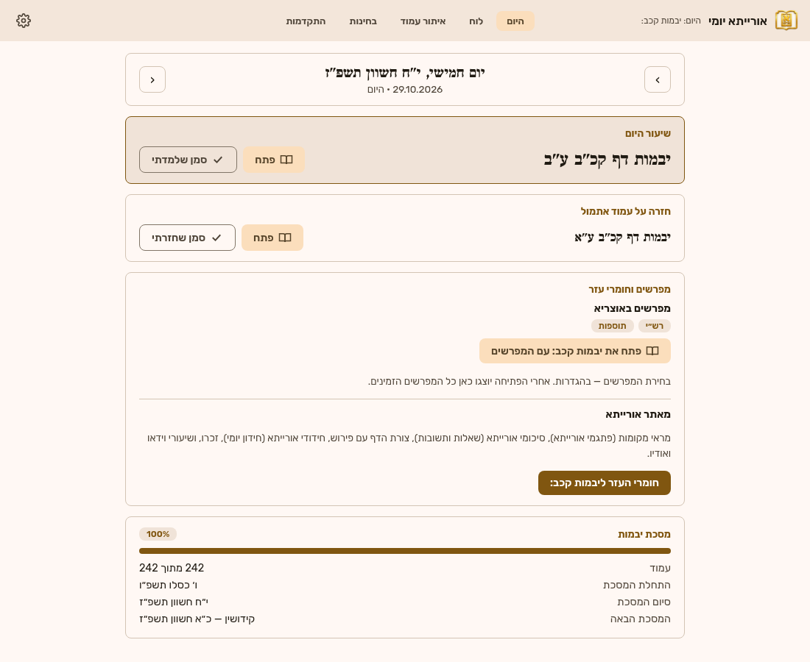
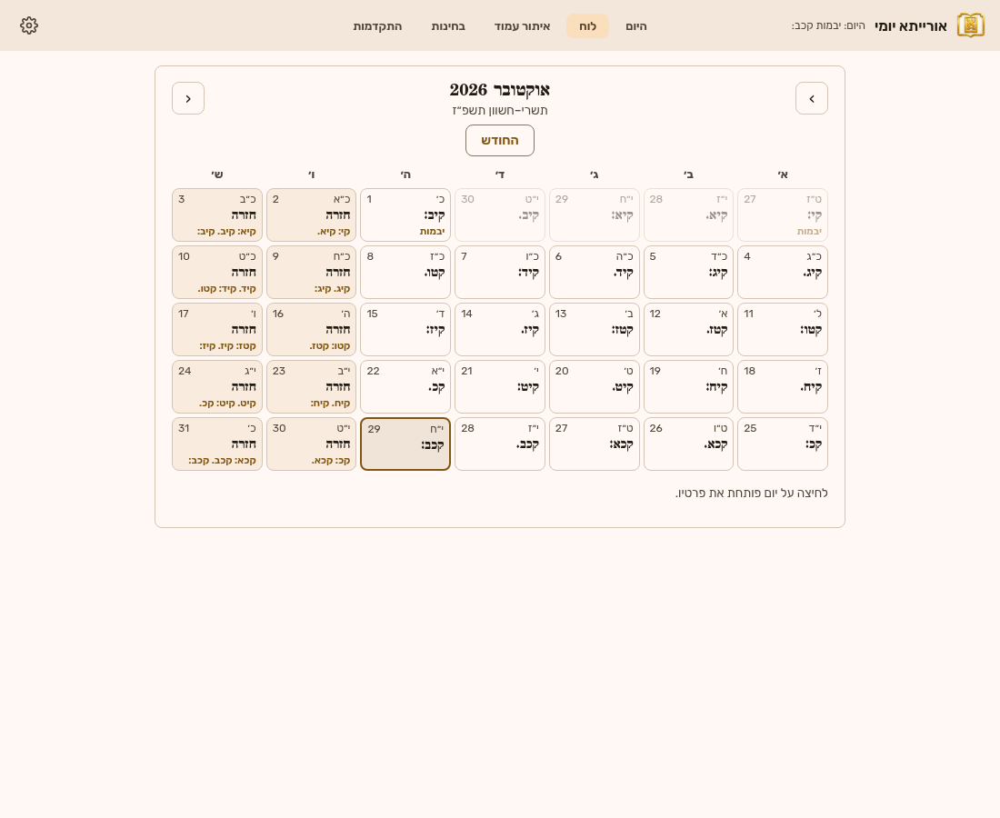
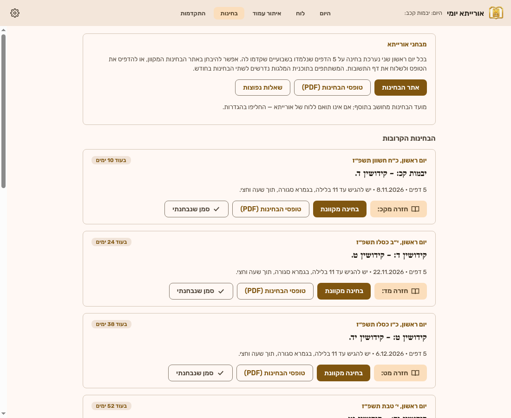

# ORAYSA — עמוד וחזרה | תוסף לאוצריא

תוסף ל[אוצריא](https://github.com/Otzaria/otzaria) שנבנה סביב מסגרת הלימוד של **ORAYSA — The Amud & Chazarah Initiative**: עמוד יומי, חזרה יומית וחזרה שבועית. הממשק משתמש בזהות הצבעונית הכחולה־תכולה של אורייתא ובמונחי התוכנית.

> התוסף אינו רשמי של ארגון אורייתא. לוחות, שיעורים ומבחנים רשמיים: [oraysa.org](https://www.oraysa.org/).

## יכולות התוכנית

- **העמוד היומי** — העמוד החדש של היום והחזרה על עמוד אתמול; בשישי ובשבת — החזרה השבועית. כפתור "פתח" פותח את הגמרא בדיוק בעמוד בקורא של אוצריא.
- **לוח** — לוח חודשי עם תאריך עברי ולועזי, העמוד של כל יום וסימון ימים שהושלמו/חסרים.
- **איתור עמוד** — בחירת מסכת/דף/עמוד ומציאת התאריך שבו לומדים אותו, החזרה למחרת והחזרה השבועית; טבלת כל המסכתות בתוכנית.
- **מפרשים** — "פתח" פותח את הגמרא עם המפרשים שנבחרו בהגדרות (ברירת מחדל: רש״י ותוספות); אחרי הפתיחה מוצגים כל המפרשים הזמינים להוספה/הסרה בלחיצה.
- **חומרי עזר רשמיים מאורייתא** — קישור לדף העמוד באתר oraysa.org עבור מראי מקומות, סיכומי אורייתא, צורת הדף עם פירוש, חידודי אורייתא וחומרי לימוד רשמיים נוספים. התוסף אינו משלב שיעורי אודיו או וידאו ואינו יוצר תוכן לימודי.
- **בחינות** — לוח הבחינות הדו-שבועיות (5 הדפים של השבועיים האחרונים), קישור לאתר הבחינות המקוון (moodle.oraysa.org) ולטופסי ה-PDF, וסימון "נבחנתי".
- **התקדמות** — סימון "למדתי"/"חזרתי", רצף ימים, ורשימת עמודים להשלמה (60 הימים האחרונים).
- **הגדרות** — חזרות רשות: אחרי 30 יום, אחרי 90 יום, וחזרת שבועיים בשבת.





## כללי הלוח

- א׳–ה׳: עמוד חדש בכל יום + חזרה על העמוד של היום הקודם.
- שישי: חזרה על שני העמודים של א׳–ב׳; שבת: חזרה על שלושת העמודים של ג׳–ה׳.
- התוכנית התחילה ביום א׳ י׳ טבת תש״פ (5.1.2020) בברכות ב׳ ע״א ונמשכת ברצף גם בחגים.
- סדר המסכתות לפי לוח אורייתא הרשמי: ברכות, שבת … חגיגה, יבמות, קידושין, כתובות. לאחר כתובות הלוח **משוער** (לפי סדר הש״ס) ומסומן כך בתוסף.
- התאריכים נבדקו מול לוח אורייתא הרשמי (ראו `tests/core.test.js`).

## התקנה

הורידו את קובץ ה-`.otzplugin` מדף ה-Releases, ובאוצריא: **כלים → תוספים → התקן תוסף חדש**.

## פיתוח

```bash
npm test          # בדיקות מנוע הלוח (Node 18+)
npm run validate  # המאמת הרשמי של אוצריא
python3 -m http.server   # תצוגה בדפדפן (בלי Otzaria: אחסון ב-localStorage, פתיחת ספרים מושבתת)
```

מבנה:

- `js/core.js` — מנוע הלוח (ללא תלות בדפדפן; נבדק ב-Node).
- `js/otzaria.js` — גשר ל-`window.Otzaria`: ערכת נושא, אחסון, איתור המסכת בבבלי ופתיחת העמוד.
- `js/app.js` — ממשק המשתמש.

הרשאות: `library.books.read`, `library.content.read` (איתור המסכת ותוכן העניינים), `reader.open` (פתיחת העמוד והמפרשים), `calendar.read` (חגים ופרשה), `app.open_url` (פתיחת חומרי העזר והבחינות של אורייתא בדפדפן).

חומרי העזר נפתחים בדפדפן ולא בתוך התוסף, כי האתרים של אורייתא אינם ברשימת הרשת המאושרת של אוצריא (`plugin_network_allowlist.txt`). מזהי המסכתות באתר ידועים עד קידושין; לעמודים מאוחרים יותר נפתח דף הבית. מועד הבחינות מחושב (נבדק מול בחינת פסחים #4A) וניתן להחלפה בהגדרות.
